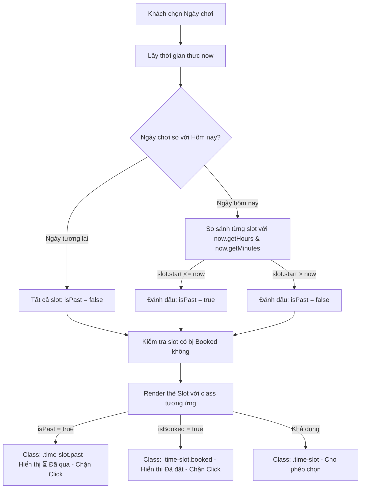

# Kế Hoạch: Hiển Thị Trực Quan & Chặn Khung Giờ Quá Khứ (Past-Time Slots UI)

> **Mã tác vụ:** `past-time-slot-ui-plan`  
> **Mục tiêu:** Nhận diện và hiển thị trực quan các khung giờ đã trôi qua trong ngày trên giao diện (UI) để khách hàng dễ dàng nhận biết, không thể click nhầm, ngăn chặn triệt để lỗi đặt sân trong quá khứ ngay từ khâu tương tác.

---

## 📌 1. Phân Tích Cơ Chế Hiện Tại (As-Is Analysis)

### 1.1 Tầng Backend (`BookingService.java`)
- **Vị trí:** Dòng 169–173 trong [`BookingService.datSan()`](file:///c:/Users/tn180/OneDrive/Desktop/QuanLyDatSanCauLong-main/backend/src/main/java/com/quanlydatsan/service/BookingService.java).
- **Cơ chế:**
  ```java
  LocalDateTime thoiDiemBatDau = LocalDateTime.of(req.getNgayChoi(), req.getGioBatDau());
  if (thoiDiemBatDau.isBefore(LocalDateTime.now())) {
      throw new ResponseStatusException(HttpStatus.BAD_REQUEST, "Không thể đặt sân trong quá khứ");
  }
  ```
- **Đánh giá:** Logic nghiệp vụ chuẩn xác, bảo vệ tầng cơ sở dữ liệu và API an toàn.

### 1.2 Tầng Frontend (`booking.js` & `booking.html`)
- **Điểm đã làm được:** 
  - Đã giới hạn `input-ngayChoi.min = today` để ngăn chọn ngày hôm qua trên lịch.
  - Đã có hàm chặn `if (selectedStartDateTime < now)` khi khách bấm nút "Tiếp tục".
- **Lỗ hổng trải nghiệm (UX Pain Points):**
  - Khi khách chọn ngày hôm nay (`ngayChoi === today`), hàm `loadAndGenerateTimeSlotsGrid()` vẫn render tất cả các slot từ sáng sớm (ví dụ `06:00 - 06:30`, `07:00 - 07:30`,...) dưới dạng **khả dụng (nền trắng/xanh, click được)**.
  - Khách hàng không biết giờ nào đã qua, vẫn click chọn slot sáng nay. Đến khi bấm "Tiếp tục" mới hiện thông báo lỗi đỏ ức chế.
  - Khách khó phân biệt giữa:
    1. Slot **chưa ai đặt** (Còn trống).
    2. Slot **đã có người khác đặt** (`.booked`).
    3. Slot **đã trôi qua theo thời gian thực** (`.past`).

---

## 🎯 2. Kiến Trúc & Thiết Kế Giải Pháp (To-Be Design)

### 2.1 Ba Trạng Thái Rõ Ràng Của Khung Giờ (Slot States)

| Trạng thái | Điều kiện | Giao diện hiển thị | Hành vi tương tác |
|------------|-----------|--------------------|-------------------|
| **AVAILABLE** (Khả dụng) | Trong tương lai & chưa có ai đặt | Nền trắng, viền xanh nhạt, hover đổi màu | Cho phép click chọn (Start/End) |
| **BOOKED** (Đã đặt) | Nằm trong dải giờ đơn đặt active | Nền xám `#e2e8f0`, chữ gạch ngang, badge *"Đã đặt"* | `pointer-events: none`, không click được |
| **PAST** (Đã qua giờ) | Ngày hôm nay và `gioBatDau <= giờ hiện tại` | Nền xám tối mờ `#f1f5f9`, `opacity: 0.5`, chữ gạch ngang, icon `⏳ Đã qua` | `pointer-events: none`, cursor `not-allowed` |

### 2.2 Luồng Logic Xử Lý Trong `booking.js`

- **Thời Gian Đệm Thực Tế (Buffer Time Rule):**
  - **Đề xuất chuẩn thực tế nhất: 15 phút.**
  - Công thức xác định slot quá khứ/không thể đặt:
    `curMin < (currentMinutes + 15)`
  - *Ý nghĩa thực tế:* 
    - Đơn đặt có 10 phút giữ chỗ thanh toán QR (`hanThanhToan = now + 10 phút`). Khách cần tối thiểu 15 phút từ lúc chọn sân đến lúc bóng lăn để hoàn tất thanh toán và vào sân khởi động.
    - Ví dụ: Lúc 15:10 (+15p = 15:25), slot 15:30 vẫn khả dụng. Nhưng lúc 15:20 (+15p = 15:35), slot 15:30 đã quá sát, slot khả dụng sớm nhất sẽ là 16:00.



---

## 📋 3. Phân Rã Công Việc Cụ Thể (Actionable Tasks)

### Phase 1: CSS & Giao Diện Trực Quan (`style.css`)
- [x] **Task 1.1:** Định nghĩa class `.time-slot.past`:
  - `background: repeating-linear-gradient(...) dashed #cbd5e1; opacity: 0.5;`
  - Chữ gạch ngang `text-decoration: line-through; color: #94a3b8;`
  - Badge trạng thái `.slot-status`: icon `⏳ Đã qua`.
  - Con trỏ chuột: `cursor: not-allowed; pointer-events: none;`
- [x] **Task 1.2:** Tách biệt rõ ràng với `.time-slot.booked`:
  - Nền xám nét liền `#f8fafc`, viền `1.5px solid #cbd5e1`, badge `🔒 Đã đặt` màu cam nổi bật.

### Phase 2: Logic JavaScript (`booking.js`)
- [x] **Task 2.1:** Bổ sung logic tính toán `isPast` trong hàm `loadAndGenerateTimeSlotsGrid()`:
  - Lấy `const now = new Date();`
  - Áp dụng đệm chuẩn 15 phút: `curMin < (currentMinutes + 15)`
- [x] **Task 2.2:** Cập nhật hàm Render HTML:
  - Phân nhánh 3 trạng thái: `isPast` -> `⏳ Đã qua`, `isBooked` -> `🔒 Đã đặt`, còn lại -> khả dụng.
- [x] **Task 2.3:** Chặn chọn dải giờ cắt ngang slot quá khứ:
  - Trong `handleTimeBlockClick(idx)` và `proceedToStep2()`, chặn và cảnh báo nếu dải giờ chứa slot `isPast`.

### Phase 3: Chú Thích (Legend) Hướng Dẫn Khách Hàng
- [x] **Task 3.1:** Thêm thanh chú thích trạng thái (Legend bar) phía trên lưới chọn giờ trong `booking.html`:
  - 🟢 Trắng: *Còn trống*
  - 🔵 Xanh: *Đang chọn*
  - 🔒 Xám viền liền: *🔒 Đã đặt*
  - ⏳ Xám sọc viền đứt: *⏳ Đã qua giờ*

### Phase 4: Kiểm Thử & Xác Nhận (Verification)
- [ ] **Task 4.1:** Kiểm tra khi chọn ngày hôm nay:
  - Giờ hiện tại (ví dụ 15:15): các ô từ `06:00` đến `15:00` phải hiển thị mờ xám `⏳ Đã qua` và không thể click.
  - Các ô từ `15:30` trở đi hiển thị bình thường.
- [ ] **Task 4.2:** Kiểm tra khi chọn ngày mai:
  - Toàn bộ các ô từ `06:00` đến `22:00` đều khả dụng (trừ các ô đã có người đặt).
- [ ] **Task 4.3:** Kiểm tra bấm nút "Tiếp tục" chỉ hợp lệ khi dải giờ hoàn toàn nằm ở tương lai.

